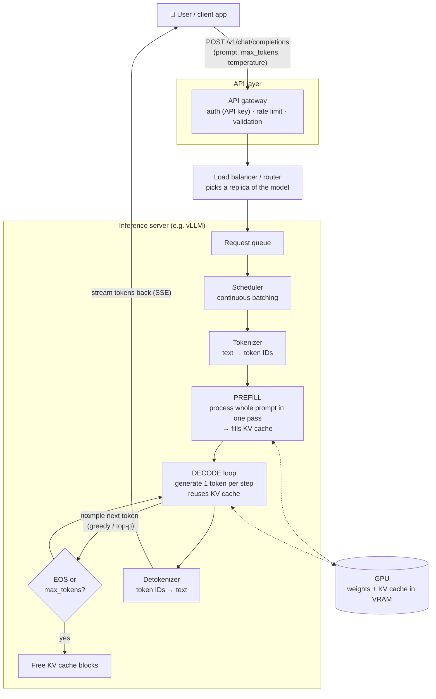

# Day 1 — AI Inference vs Training

**Date:** 18 Oct 2026 · **Resource:** [Hugging Face LLM Course, Chapter 1](https://huggingface.co/learn/llm-course/chapter1/1)

**Today's task:** Draw the request-to-response flow of an LLM inference request.

---

## 1. Training vs inference

| | Training | Inference |
|---|---|---|
| Goal | Learn the weights | Use the fixed weights to answer requests |
| Passes | Forward **+ backward** (gradients) | Forward only |
| Weights | Change every step | Frozen, read-only |
| Runs | Once (weeks, thousands of GPUs) | Forever, millions of times a day |
| Optimised for | Total throughput / time-to-train | Latency, throughput **and cost per request** |
| Memory used by | Weights, gradients, optimizer state, activations | Weights + **KV cache** + small activations |

**Key idea:** a model is trained once but served millions of times, so most of a model's lifetime cost
is inference. An inference engineer's job is to make each answer fast, cheap and reliable.

## 2. Open vs closed models

- **Closed models** (e.g. GPT, Claude, Gemini): weights stay private. You only reach them through
  the provider's API. Easy to use, but you can't change how they're served.
- **Open-weight models** (e.g. Llama, Mistral, Qwen, Gemma): you can download the weights and run them
  on your own hardware with engines like vLLM, SGLang or llama.cpp. This is where most
  inference-engineering work happens: you pick the GPU, precision, batching and caching.

## 3. Shared vs dedicated inference

- **Shared (serverless):** many customers share the same GPUs. You pay per token, with no idle cost,
  but latency can vary with other people's traffic ("noisy neighbours").
- **Dedicated:** you rent GPUs that only run your model. You pay per GPU-hour, so it's only cheap
  if you keep them busy. In exchange you get predictable latency and full control.

Rule of thumb: low or spiky traffic → shared; high steady traffic or strict latency needs → dedicated.

## 4. The inference stack (top → bottom)

```
Application        chat UI, agent, app code
API layer          HTTP / OpenAI-compatible API, auth, rate limits
Serving / routing  load balancer, request queue, model router
Inference engine   vLLM / SGLang / TensorRT-LLM / llama.cpp — scheduler, batching, KV cache
Runtime & kernels  PyTorch, CUDA, FlashAttention
Hardware           GPU (VRAM, memory bandwidth, FLOPS), CPU, network
```

## 5. Request-to-response flow (today's deliverable)



**Where latency comes from:**

- **Time to first token (TTFT)** = network + queueing + tokenizing + **prefill**
- **Inter-token latency** = time per **decode** step
- **End-to-end latency** = TTFT + (output tokens × inter-token latency)

Prefill is usually **compute-bound** (many prompt tokens processed in parallel). Decode is usually
**memory-bandwidth-bound**, because every new token has to read all the weights from VRAM again.
Weeks 3–4 cover this in detail.

## 6. Hands-on: simulate a request

[`simulate_request.py`](simulate_request.py) walks through every stage of the diagram with a toy
"model" and prints a timeline with TTFT and tokens/sec. It needs only the standard library:

```bash
python3 simulate_request.py "Explain inference in one line"
python3 simulate_request.py --prompt-tokens 2000   # long prompt → watch TTFT grow
```

## 7. Self-test (answer before checking notes)

1. Why doesn't inference need a backward pass?
2. Name two things that take up GPU memory during inference.
3. When would you choose dedicated inference over shared?
4. Which stage decides TTFT: prefill or decode?
5. Why does a longer prompt increase TTFT but barely change per-token speed?

## 8. What I learned today

- _Write 3–5 bullets here in your own words._
